# 

## Introduction

Yla (derived from Yggdrasil Lua) is a modularized Lua scripting engine for [Yggdrasilcore](https://github.com/YggdrasilWotLK/yggdrasilcore) based on AzerothCore's mod-ale, itself a fork of ElunaLuaEngine. It lets server administrators and developers create custom gameplay features, events and mechanics without modifying the core server code.

[](http://www.lua.org/manual/5.2/)
[](http://www.lua.org/manual/jit/)

Read more about Yggdrasil WoW and see Yggdrasilcore, including Yla, in action [here](https://yggdrasilwow.com/).

## Compatibility

> [!IMPORTANT]
> Yla is NOT compatible with AzerothCore, ALE or Eluna. It includes significant performance improvements from mod-ale, including multistate support and thread safety alignments with the Yggdrasilcore core, that are incompatible with stock AzerothCore scripts. Scripts written for stock ALE or Eluna will not work with Yla, and scripts written for Yla will not work with them.

Yla has diverged from mod-ale and from the original Eluna project. Its API, state handling and threading model differ from upstream mod-ale, so scripts are not interchangeable in either direction. In practice, Yla sits somewhere between mod-yla and Eluna Lua Engine. Always refer to Yla specific behavior when developing scripts, and do not expect upstream documentation to be accurate for it. Up to date documentation can always be found on our [documentation page](https://yggdrasilwotlk.github.io/mod-yla/).

If you need stock ALE or Eluna compatibility, use the upstream projects instead: [mod-ale](https://github.com/azerothcore/mod-ale) for AzerothCore's ALE or [ElunaTrinityWotlk](https://github.com/ElunaLuaEngine/ElunaTrinityWotlk) for the original Eluna API.

## Project Design

### Multistate implementation


1. Multistate is modelled after upstream ElunaLuaEngine.
2. Custom additions facilitate true cross-state (and cross-thread) communication, including `RunCommand` cross-map teleports deferred to the world state (when maps sleep).
3. Serialized `SetWorldData`/`GetWorldData` and `SetMapData`/`GetMapData` make information dissemination possible between states. Each data key can only be written to from its native state.
4. State validation of all objects (i.e., an object on a map other than the state map throws a Lua error, a custom addition for thread safety), and state filtering on methods (i.e., group methods can only run on the world state, like upstream).

### Multistate scripting models

#### Map event fetching static content from the database

1. The world state fetches database content and stores it as `SetWorldData`.
2. When map events trigger (change map, talk to creature, etc.), the map can query `GetWorldData` and populate a cache of its own from a recursive mutex read on the world data, thereby requiring minimal database operations and minimal cross-state communication.

#### Map-based actor that should have world-available information

1. As upstream, object-specific `Data()` is available here. It is cleared on object destruction (i.e., player logout for example).
2. Note, however, that the `Data()` is serialized in the Lua engine, and is not accessible to the underlying C++ core, unlike ElunaLuaEngine.

### Information and event dissemination flow



- **World info → maps:** `SetWorldData()` in the world state, `GetWorldData()` in map states. Use it to establish per-map caches from world data; re-read sparingly due to mutexing.
- **Map info → other maps / world:** `player:Data()` or `GetMapData`.
- **Map event → world event:** bridge through `player:RunCommand`, which defers the object context to when maps sleep.
- **World event → map event:** bridging generally not required, most methods that mutate map objects can be safely run in the world state. If not sufficient, consider EMQ or `CreateLuaEvent` polling data between maps using `GetMapData`/`GetWorldData`.

## Installation

### Prerequisites
- [Yggdrasilcore](https://github.com/YggdrasilWotLK/yggdrasilcore) server installation
- Git
- CMake

### Installation Steps

```bash
# Navigate to your Yggdrasilcore modules directory
cd <yggdrasilcore-path>/modules

# Clone the mod-yla repository
git clone https://github.com/YggdrasilWotLK/mod-yla.git

# Configure build with your preferred Lua version
cd <yggdrasilcore-build-directory>
cmake ../ -DLUA_VERSION=luajit  # Options: luajit, lua52, lua53, lua54

# Default: If no version is specified, Lua 5.2 will be used

# Rebuild your Yggdrasilcore server
make -j$(nproc)
```

### Supported Lua Versions
- LuaJIT (default, recommended)
- Lua 5.2
- Lua 5.3
- Lua 5.4

## Documentation

- [Installation Guide](https://github.com/YggdrasilWotLK/mod-yla/tree/master/docs/USAGE.md)
- [Implementation Details](https://github.com/YggdrasilWotLK/mod-yla/tree/master/docs/IMPL_DETAILS.md)
- [Hooks Documentation](https://github.com/YggdrasilWotLK/mod-yla/blob/master/src/LuaEngine/Hooks.h)
- [Lua 5.2 Reference](http://www.lua.org/manual/5.2/)

The upstream [mod-ale API Documentation](https://www.azerothcore.org/eluna/) is a reference for the shared base only and may not match Yla.

## Support

Yla is a downstream fork and we do not provide official public support for it. Upstream channels do not support Yla specific behavior. However, if you do decide to use Yla in your server and find any issues, feel free to report bugs and/or open PRs here. You may also find help in the AzerothCore Discord community's mod-ale channel or the Eluna Lua Engine Discord community due to the similar nature of these code bases.

- [Yla GitHub Issues](https://github.com/YggdrasilWotLK/mod-yla/issues)
- [AzerothCore Discord Community](https://discord.com/invite/bx3y5Qmy)
- [Eluna Discord Community](https://discord.gg/bjkCVWqqfX)

## Contributing

Yla is a privately managed repository. We do not recommend emulation enthusiasts to follow it. Instead, we recommend that enthusiasts contribute to the upstream mod-ale project at [azerothcore/mod-ale](https://github.com/azerothcore/mod-ale). See their information on how to contribute [here](https://www.azerothcore.org/wiki/contribute).

## Acknowledgements

Yla is built upon mod-ale, which in turn is built upon the original [Eluna](https://github.com/ElunaLuaEngine/Eluna) project. We thank the original Eluna team for their pioneering work in Lua scripting for World of Warcraft server emulators.

- [Original Eluna Repository](https://github.com/ElunaLuaEngine/Eluna)
- [Eluna Discord Community](https://discord.gg/bjkCVWqqfX)

## License

- Source: This repository is distributed under a GNU General Public License v3.0.
- Intellectual property: Yla is not related to Blizzard Entertainment. Yggdrasil WoW and its derivative projects lay no claim to Blizzard Entertainment's copyrights and intellectual property, and operate this project solely as an avenue for exploring the functionality of the abandonware WotLK 3.3.5a client in an educational capacity.
